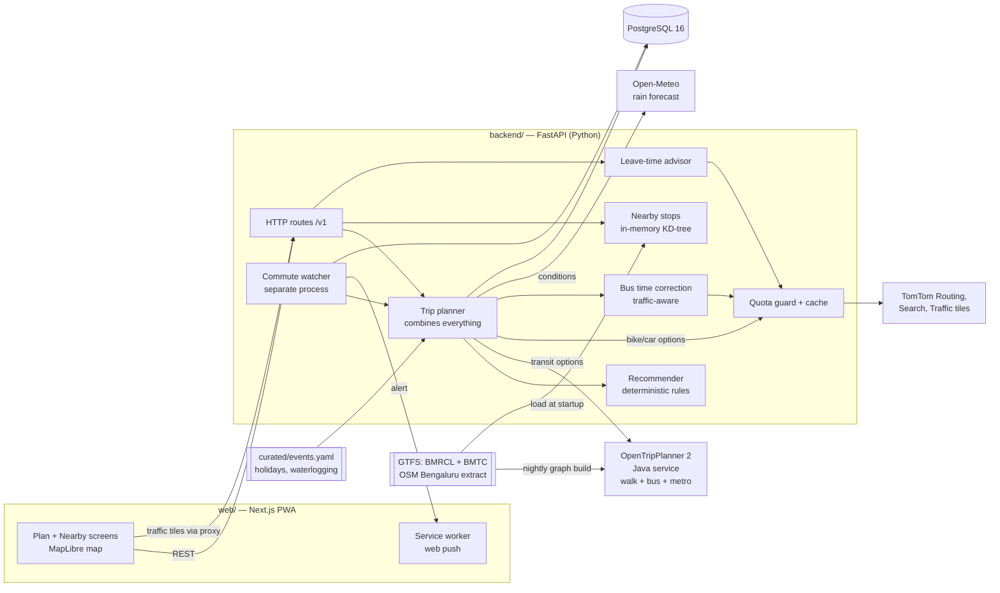

# Sari-Daari — Architecture

> *Sari daari* (ಸರಿ ದಾರಿ): "the right way". For each trip it answers one question:
> **metro, bus, or your own bike/car, and how do I get to the station or stop?**

Status: design, revision 2 (2026-10-18). Nothing below is implemented yet.

**Revision 2:** buses are now in the first version; added nearby stops and the right stop to walk to;
the audience is everyone living in Bengaluru (no login needed, Kannada + English); transit routing
moves to OpenTripPlanner.

---

## 1. Who it's for and what it does

**Who:** anyone living in Bengaluru, on their phone. Works without signing in. Kannada + English
(the BMTC feed already has Kannada stop names).

Google Maps already shows live traffic, so copying that is not the product. The product is a
**decision for each trip, plus the exact place to walk to**:

> *(made-up example: numbers, routes and gates are only there to show the layout)*
>
> **Koramangala 5th Block → Whitefield (ITPL), now, 8:50 am**
> 🚇 **Auto + metro: 48–55 min · ₹60** ← *recommended*
>   Auto 12 min to **Indiranagar metro (Gate B)** → Purple Line, 24 min → walk 6 min
> 🚌 **Bus: 75–95 min · ₹30** (route X from Forum Mall stop, every 10 min. Same traffic as your bike)
> 🏍 **Your bike: 68 min · ₹45 fuel** (normally 38. Traffic is 1.8× normal on ORR)
> 💡 Leave after 10:40 and the bike takes 40 min.

| Feature | Version |
|---|---|
| Door-to-door comparison: **metro, bus, bike, car**, and combinations (walk/auto + metro, bus + metro) | first version |
| **Nearby stops**: closest metro stations (by entrance) and bus stops, with walking time, lines/routes served, how often they run | first version |
| **The right stop, not just the nearest**: the stop or station the best trip actually starts from | first version |
| Live traffic on the road route + 2 alternate routes; peak-hour warning | first version |
| Saved commutes (home ↔ office), works without an account | first version |
| Leave-time advice, push alerts before you usually leave | v1 |
| **Weather** (rain penalties, rain forecast in leave-time advice) and **festival/event calendar** | first version |
| Metro crowding hint, "how long did it take?" feedback | v2 |
| Live bus positions | only with official BMTC data access (see §8) |

Out of scope: turn-by-turn navigation (hand off to the phone's maps app), ticketing (Namma Yatri, BMRCL and
Namma BMTC apps already do it).

---

## 2. System overview



Request flow for `POST /v1/plan`:

1. **Geocode** if given text: TomTom Search limited to the Bengaluru area, cached for 30 days.
2. Run in parallel:
   - **Transit:** ask OTP for up to 5 options (`WALK,BUS,SUBWAY`, plus "auto to station" via OTP's
     car-to-station mode, with walking limited to about 1.5 km).
   - **Road:** TomTom `calculateRoute`, `traffic=true`, `maxAlternatives=2`, for each vehicle the user has.
3. **Fix the bus times** (§3.3). OTP's bus times come from schedules, and buses sit in the same traffic as cars.
4. Add up cost, attach the nearest station entrance for each boarding point, **score and recommend** (§3.5).
5. Store an observation row (that's how history builds up), then return.

---

## 3. Components

### 3.1 Transit routing: OpenTripPlanner 2 (separate Java service)
Revision 1 planned a small router written by hand, which was fine for 80 metro stations. With buses the feed is
**~10k stops, 4.4k routes, 58k trips, 1.5M stop times**, and planning on it needs a proper
transit algorithm (RAPTOR) plus walking over real streets. OTP2 has both, is proven, and reads
our feeds directly:

- Graph inputs: `bmrcl.zip` + `bmtc.zip` (Vonter, ODbL) + a Bengaluru OSM extract
  (Geofabrik `india/southern-zone`, cut to the city's bounding box with `osmium`).
- Rebuild the graph nightly/weekly, then **swap it in without downtime** (start the new graph, switch the port, stop the old one).
- Our backend only talks to it through a `TransitRouter` interface, so OTP can be replaced
  (e.g. by a Python RAPTOR) without touching the planner. Tests use a `FakeTransitRouter`.
- Java 21+ (Java 25 is already installed on the dev Mac). Native jar, no Docker.
- **Memory:** plan for 3–4 GB to serve and more while building the graph. Measure once it's built. This sets the hosting cost (§6).

This doesn't conflict with "backend in Python". OTP is a separate service like Postgres, and all our logic
stays in FastAPI.

### 3.2 Nearby stops + the right stop
- At startup, load stops from both feeds: metro **entrances** (`location_type=2`), metro stations, and bus stops
  (BMTC lists each direction as its own stop, e.g. *"… (Towards AIT College)"*, so we show the direction).
- Build an in-memory KD-tree with `scipy.spatial.cKDTree` on projected coordinates. ~10k points, microseconds per query, no PostGIS.
- `GET /v1/nearby`: the k nearest **metro stations** (distance to the closest entrance) and **bus stops**,
  each with straight-line distance → walking time (× 1.3 detour factor, real walking route from OTP on tap),
  the routes/lines that stop there, and how often they run in the current hour (from `stop_times` grouped by route).
- **Right stop vs. nearest stop:** the nearest stop may not have a bus to where you're going. The plan shows
  the stop the best option actually boards at ("walk 4 min past the nearer stop to Forum Mall, where 500D stops").

### 3.3 Bus time correction (traffic-aware buses)
BMTC schedules are known to be wrong (the feed's author warns about this), and a bus sits in the same jam
as a car. So for every bus leg:

```
bus_ride = schedule_time(board→alight) × road_delay_ratio(board→alight) × BUS_FACTOR (≈1.15, stops/dwell)
```
`road_delay_ratio` = TomTom time with traffic ÷ time without traffic for the same stop pair, cached per (stop pair, 15-min slot).
Waiting = headway/2 from how often the route runs, capped at 15 min. Bus options are always shown as a **range**.
Bus lanes (e.g. ORR) get a lower factor later, when we have the data to back it.

Quota note: this adds about 1 TomTom call per bus leg, but stop pairs repeat a lot between users, so the cache absorbs most of it.

### 3.4 Road providers: Strategy + Adapter
```python
class RoadRouter(Protocol):
    async def routes(self, o: LatLng, d: LatLng, mode: RoadMode,
                     depart_at: datetime | None, alternatives: int) -> list[RoadRoute]: ...
```
`TomTomRouter` (default; free plan about 2,500 non-tile requests/day, pricing changed 2026-07-01, so check again),
`GoogleRouter` (optional, paid, real `TWO_WHEELER` ETAs), `FakeRouter` (recorded fixtures, no network in tests).
Each adapter converts its provider's format into our own `RoadRoute`; core code never sees a provider's raw format.

### 3.5 Recommender (deterministic rules, no AI)
Every option has `duration_s`, `duration_range_s`, `cost_inr`, `walk_m`, `transfers`, `reliability`
(road at peak = low, metro = high, bus = low at peak).

```
fastest  = option with the lowest duration (upper end of its range)
if metro option within SAVE_MIN (5 min) of fastest and its reliability is higher → recommend metro
elif fastest is road and delay_ratio ≥ PEAK_RATIO (1.5)                         → recommend it + "leave at <advice>"
else                                                                             → recommend fastest
cheapest option is always labelled; "least walking" is labelled when it differs
```
Every option comes with short **reasons**. The thresholds live in config. User preferences ("I don't own a vehicle",
"max walk 1 km", "avoid autos") filter options **before** scoring.

### 3.6 Leave-time advisor
TomTom `departAt` (TomTom's predicted traffic) every 15 min across −60…+120 min around the requested time,
for the road option and the bus correction. Returns the earliest and latest departure where `delay_ratio < PEAK_RATIO`.
About 12 calls each, cached for 6 h. Once we have about 4 weeks of our own history, that replaces TomTom's prediction.

### 3.7 Quota guard + cache
**Serving the whole city on a free plan means cost control is part of the design.**
- Cache key: start and destination snapped to geohash-7 (~150 m), plus mode, plus a 5-min time bucket.
  TTL: 5 min live, 6 h predicted, 30 days geocoding, 15 min bus stop-pair ratios.
- Daily budget in `api_usage`, split by feature (plan 55%, bus correction 20%, watcher 15%, leave-time 10%).
  When a share runs out, that feature falls back to cached or history data and the UI says so ("traffic as of 9:05").
- Watch the cache hit rate from day one. It tells us when we have to move to a paid plan.

### 3.8 Commute watcher
Its **own process** (`python -m sari_daari.worker`, APScheduler), so several API workers don't each run the job.
Polls saved commutes every 15 min starting 60 min before the usual time, stores observations, and sends one deduplicated web push
when the road delay crosses the threshold or the recommendation changes.

### 3.9 Conditions: weather + festivals/events
Live traffic already shows today's jam, rain or festival **as it happens**. Conditions covers what live traffic can't:
predictions for a later time, metro/bus timing changes, and keeping odd days out of our history.

**Weather** (`conditions/weather/open_meteo.py`: free, no key, hourly forecast + 15-min rain amounts):
| Rain level | Effect (config) |
|---|---|
| none / light (< 2.5 mm/h) | none |
| moderate (2.5–7.5) | bike/walk penalty, max walk cut to 600 m, auto wait +5 min, road ranges wider |
| heavy (> 7.5) | stronger bike penalty, "avoid flood-prone roads" warning on routes through curated waterlogging spots, metro preferred when times are close |
- Leave-time advice also looks at the forecast: "rain expected 6–7pm, leave before 5:45".
- Rain-time penalties are **rules we assume**, not measurements. Observations are tagged with the rain level, so the factors can be learned later.

**Calendar** (`curated/events.yaml`, updated by pull request; there's no admin panel):
```yaml
- id: ipl-2027-03-28-rcb
  name: { en: "IPL match at Chinnaswamy", kn: "…" }
  window: { start: 2027-03-28T17:00+05:30, end: 2027-03-28T23:59+05:30 }
  area: { center: [12.9788, 77.5996], radius_m: 2500 }   # or a GeoJSON polygon
  road_factor: 1.4             # applied to predictions only; live traffic already reflects it
  metro: { extended_until: "00:30", note: { en: "Last train extended" } }
  closures: []                 # optional road names for the banner
  source: https://…            # BTP / BMRCL advisory link, required
```
- Kinds: public holidays (Karnataka list), festivals (Ganesh Chaturthi processions, Karaga, Kadlekai Parishe, Diwali),
  events (IPL, concerts), bandhs/protests, advisories about VIP movements or road closures from BTP.
- Effects: an **event banner** when the route passes through the area; `road_factor` on **predicted** times only;
  metro timing overrides; **observations inside an event are tagged and left out** of the normal-day history model.
- Holidays also change the bus/metro service day (Sunday timetable). Use the feeds' `calendar_dates` first, then events.yaml.

`conditions/adjust.py` combines weather + events into one `Conditions` object that the planner,
recommender and leave-time advisor take as input. It's a pure function, easy to test.

### 3.10 Live traffic map
MapLibre GL with TomTom raster traffic-flow tiles over an OSM base map, fetched through
`/v1/tiles/traffic/{z}/{x}/{y}` (keeps the key out of the browser, 60 s cache). Metro lines are drawn from GTFS shapes, in the lines' official colours.

---

## 4. Data model (PostgreSQL 16)

```
devices(id, created_at, lang)                     -- anonymous; optional magic-link account later
places(id, device_id, label, lat, lon)            -- "Home", "Office"
preferences(device_id, vehicles text[], max_walk_m, avoid text[])
commutes(id, device_id, origin_place, dest_place, usual_depart time, days int[], active)
route_observations(id, commute_id null, o_cell, d_cell, mode, requested_at, depart_at,
                   duration_s, free_flow_s, distance_m, provider, alt_rank,
                   rain_level, event_ids text[])    -- tags so odd days don't skew history
bus_leg_ratios(board_stop, alight_stop, slot, ratio, observed_at)   -- feeds the bus time correction
push_subscriptions(id, device_id, endpoint, p256dh, auth)
api_usage(provider, day, feature, count)
provider_cache(key, payload jsonb, expires_at)    -- UNLOGGED
```
Transit data (stops, routes, timetables) stays **in OTP and in memory**, not in Postgres. Feed updates
are file swaps, not migrations.

---

## 5. API (v1)

| Method | Path | Purpose |
|---|---|---|
| POST | `/v1/plan` | `{origin, destination, depart_at?, vehicles[], max_walk_m?, avoid[]?}` → options, recommendation, reasons |
| GET | `/v1/nearby?lat=&lon=` | nearest metro stations (entrance + gate) and bus stops, with walking time, routes served, how often they run |
| GET | `/v1/metro/stations`, `/v1/metro/stations/{id}` | lines, gates, first/last train, how often trains run |
| GET | `/v1/bus/stops/{id}` | one bus stop: routes, direction, approximate next departures |
| GET | `/v1/leave-advice` | best departure window (weather and events taken into account) |
| GET | `/v1/conditions?lat=&lon=&at=` | rain now + next 3 h, active/upcoming events nearby (for banners) |
| CRUD | `/v1/commutes`, `/v1/places`, `/v1/preferences` | per device |
| GET | `/v1/geocode?q=` | proxied, cached search limited to the Bengaluru area |
| GET | `/v1/tiles/traffic/{z}/{x}/{y}` | proxied traffic tiles |
| POST | `/v1/push/subscribe` | web push |

Local time `Asia/Kolkata` at the edges, UTC in storage. Response text keys are ready for translation (en/kn).

---

## 6. Tech stack and hosting

| Tech | Role | Why |
|---|---|---|
| Python 3.13, FastAPI, Pydantic v2, httpx | API + planner | Your stack; the work is mostly waiting on network calls, which async handles fine |
| OpenTripPlanner 2 (Java 21+) | Transit routing | Proven RAPTOR + walking over streets; reads our feeds directly |
| SQLAlchemy 2 + Alembic, PostgreSQL 16 | State, history, cache, quota | Already installed natively (no Docker) |
| APScheduler (worker process) | Commute watcher | No Redis/Celery for now |
| scipy `cKDTree` | Nearby stops | Fast enough for 10k points |
| Open-Meteo | Weather: hourly forecast + 15-min rain | Free, no key; behind `WeatherProvider` so another source can replace it |
| uv, ruff, pytest | Tooling | Fast and reproducible |
| Next.js + TypeScript, MapLibre GL, `openapi-typescript` | `web/` PWA | Mobile-first; TS types generated from FastAPI's OpenAPI spec |

**Hosting:** OTP's memory means **one always-on server with 4–8 GB RAM** (e.g. a Hetzner/DigitalOcean-class VPS,
roughly ₹500–1,500/month) running OTP + API + worker + Postgres. Frontend on Vercel. Free tiers that put the app to sleep
don't work: the watcher has to stay running, and OTP takes minutes to load its graph.

---

## 7. Repository layout

The code is organised **by travel mode**: everything about the metro lives in `modes/metro/`,
everything about your own bike/car in `modes/private_vehicle/`, and so on. Each mode folder owns its data
loading, stops/stations, timing, fares/costs and tests. Shared pieces sit around the modes:

- `core/`: models and interfaces every mode uses (LatLng, Leg, TripOption, Conditions).
- `traffic/`: live road traffic. **It's a shared service, not part of private_vehicle**, because buses
  (time correction), autos to the station, and leave-time advice all need road traffic too.
- `journeys/`: combining modes into door-to-door trips (OpenTripPlanner search for bus + metro trips with
  transfers, the planner, the recommender).

### Import rules (checked in CI with `import-linter`)
```
api  →  journeys  →  modes/*  →  traffic, conditions  →  core
                                                         ↑
infra (db, cache, quota) is reached only through interfaces defined in core
```
- **Modes never import each other.** `metro/` doesn't know `bus/` exists. Only `journeys/` combines them.
- Adding a new mode (e.g. Namma Yatri autos, Yulu, suburban rail) = add a folder in `modes/` + register it in `journeys/`.

```
sari-daari/
├── backend/
│   ├── pyproject.toml · uv.lock · .importlinter
│   ├── src/sari_daari/
│   │   ├── main.py                       # app factory: connects providers, modes, journeys and api
│   │   ├── config.py                     # pydantic-settings; settings grouped by mode
│   │   │
│   │   ├── core/                         # shared, no I/O
│   │   │   ├── geo.py                    # LatLng, BBox, geohash cell, haversine, KD-tree helper
│   │   │   ├── trip.py                   # Mode, Leg, TripOption, DurationRange, Cost
│   │   │   ├── conditions.py             # RainLevel, Event, Conditions
│   │   │   ├── recommendation.py         # Recommendation, Reason (text key + params)
│   │   │   └── ports.py                  # interfaces: RoadRouter, TransitSearch, WeatherProvider, Cache, Quota…
│   │   │
│   │   ├── modes/
│   │   │   ├── metro/                    # 🚇 Namma Metro (BMRCL)
│   │   │   │   ├── feed.py               # loads bmrcl.zip: lines, stations, entrances/gates, how often trains run
│   │   │   │   ├── stations.py           # nearest stations by entrance, lines at a station
│   │   │   │   ├── timing.py             # ride range, waiting time, interchange penalty, first/last train
│   │   │   │   ├── fares.py              # fare between two stations from GTFS
│   │   │   │   ├── overrides.py          # extended hours / closures from curated/metro + events
│   │   │   │   └── README.md             # data source, caveats, licence
│   │   │   │
│   │   │   ├── bus/                      # 🚌 BMTC
│   │   │   │   ├── feed.py               # loads bmtc.zip: ~10k stops, routes, how often they run, Kannada names
│   │   │   │   ├── stops.py              # nearby stops with direction ("Towards …"), routes at a stop
│   │   │   │   ├── timing.py             # timetable time × road delay ratio × bus factor, waiting time
│   │   │   │   ├── fares.py
│   │   │   │   └── README.md
│   │   │   │
│   │   │   ├── private_vehicle/          # 🏍 🚗 your own bike / car
│   │   │   │   ├── routes.py             # fastest + 2 alternate routes via traffic/, delay ratio
│   │   │   │   ├── bike.py               # two-wheeler: rain penalty, per-user correction for filtering through traffic
│   │   │   │   ├── car.py                # parking time + cost at the destination
│   │   │   │   ├── costs.py              # fuel ₹/km by vehicle type
│   │   │   │   └── README.md
│   │   │   │
│   │   │   └── last_mile/                # 🚶 🛺 getting to and from a station or stop
│   │   │       ├── walk.py               # walking time (detour factor; real walking route from OTP on tap)
│   │   │       ├── auto.py               # auto ETA via traffic/ + waiting time + meter fare
│   │   │       └── README.md
│   │   │
│   │   ├── traffic/                      # shared live road traffic
│   │   │   ├── providers/                # tomtom.py · google.py · fake.py (all follow RoadRouter)
│   │   │   ├── delay.py                  # delay ratio, cache per stop pair and 15-min slot
│   │   │   └── tiles.py                  # traffic tile proxy
│   │   │
│   │   ├── conditions/                   # weather + festivals/events
│   │   │   ├── weather/                  # open_meteo.py · fake.py · levels.py (mm/h → RainLevel)
│   │   │   ├── calendar.py               # curated/events.yaml + holidays.yaml
│   │   │   └── adjust.py                 # weather + events → Conditions (pure)
│   │   │
│   │   ├── journeys/                     # combines the modes into door-to-door options
│   │   │   ├── transit_search/           # otp.py (GraphQL) · fake.py: bus + metro + transfers
│   │   │   ├── planner.py                # runs all modes in parallel → TripOptions
│   │   │   ├── right_stop.py             # the stop/station the best trip actually starts from
│   │   │   ├── scoring.py                # applies Conditions + user preferences
│   │   │   ├── recommend.py              # deterministic rules → Recommendation + reasons
│   │   │   └── leave_time.py             # departAt sweep + rain forecast + events
│   │   │
│   │   ├── places/                       # geocoding (TomTom search, cached), saved places
│   │   ├── commutes/                     # saved commutes, preferences (per device)
│   │   │
│   │   ├── api/v1/                       # thin routers, grouped the same way
│   │   │   ├── plan.py · leave_advice.py · conditions.py
│   │   │   ├── metro.py                  # /v1/metro/stations, /v1/metro/stations/{id}
│   │   │   ├── bus.py                    # /v1/bus/stops/{id}
│   │   │   ├── nearby.py                 # metro + bus nearby, merged
│   │   │   ├── places.py · commutes.py · push.py · tiles.py
│   │   │
│   │   ├── infra/                        # db.py · models.py · cache.py · quota.py · observations.py · webpush.py
│   │   └── worker/                       # __main__.py · commute_watcher.py · refresh.py
│   │
│   ├── migrations/                       # Alembic
│   └── tests/                            # same layout as src/
│       ├── modes/{metro,bus,private_vehicle,last_mile}/
│       ├── traffic/ · conditions/ · journeys/
│       ├── api/                          # integration: API + Postgres, providers faked
│       └── fixtures/                     # recorded responses: tomtom/ otp/ open_meteo/ · mini GTFS feeds
│
├── curated/                              # hand-maintained data, changed through reviewed PRs, checked against schema/
│   ├── events.yaml · holidays.yaml       # shared across modes
│   ├── metro/station_notes.yaml          # "few autos at gate B", entrance quirks
│   ├── bus/route_notes.yaml              # known-wrong timetables, missing routes
│   ├── private_vehicle/parking.yaml      # parking cost/time for areas people commute to
│   ├── roads/waterlogging.geojson        # flood-prone spots, each with a source
│   └── schema/
│
├── otp/                                  # build-config.json · router-config.json · build_graph.sh · serve.sh · graphs/ (ignored)
│
├── web/                                  # Next.js PWA
│   ├── app/                              # page.tsx (Plan) · nearby/ · commutes/ · layout.tsx · manifest.ts
│   ├── components/
│   │   ├── modes/
│   │   │   ├── metro/                    # MetroLegCard, StationCard, MetroLinesLayer
│   │   │   ├── bus/                      # BusLegCard, BusStopCard
│   │   │   ├── private_vehicle/          # RoadOptionCard, AlternateRoutes
│   │   │   └── last_mile/                # WalkLeg, AutoLeg
│   │   ├── map/                          # MapView, TrafficLayer, RouteLine
│   │   ├── plan/                         # RecommendationBanner, OptionList, LegTimeline
│   │   └── conditions/                   # RainChip, EventBanner
│   ├── lib/                              # api/ (generated types + client) · i18n/ (en, kn) · device.ts
│   └── public/                           # icons, sw.js
│
├── scripts/                              # fetch_data.py · cut_osm.sh · gen_api_types.sh
├── data/                                 # gitignored: gtfs/metro, gtfs/bus, osm/
├── docs/
├── .github/workflows/ci.yml              # ruff, import-linter, pytest, curated schema check, web build
├── Makefile                              # make data · make graph · make dev · make test
└── .env.example · LICENSE · README.md
```

## 8. Risks and how we handle them

| Risk | Handling |
|---|---|
| **BMTC timetables are wrong**, and only routes with working live tracking are in the feed | Traffic-corrected bus times shown as ranges (§3.3); "this route may be missing" note; collect user reports (v2) |
| Metro GTFS times are approximate | Show as ranges; fetch the feed weekly |
| No official live bus/metro data | **Don't** scrape the Namma BMTC app's private API. Ask BMTC/DULT for official access (they shared GTFS for the 2024 Enroute challenge) |
| TomTom quota with city-wide users | Cache + quota guard (§3.7); watch the hit rate; budget for a paid plan before public launch |
| OTP memory / ops | Single VPS sized for it; graph swap without downtime; `TransitRouter` interface keeps a lighter router possible |
| Bike ETAs are wrong (bikes filter through traffic) | v2 per-user correction from "how long did it take?" feedback |
| Getting an auto at a station is hard / surge pricing | Auto waiting time in config; per-station flag later |

## 9. Data licences

- **BMRCL GTFS** and **BMTC GTFS** (Vonter): **ODbL 1.0**. Credit "Vonter / BMRCL / BMTC" in the app. A changed copy of the database
  that we distribute stays ODbL. **Feeds are never committed**; `scripts/fetch_data.py` downloads them.
  The BMTC feed was built by a third party from the Namma BMTC app. Before any commercial launch, get official data from BMTC.
- **OpenStreetMap**: © OpenStreetMap contributors (ODbL).
- **TomTom**: follow their attribution rules on the map.
- OpenCity metro ridership (v2 crowding hint) is **CC BY-NC-SA**, so only while the app stays non-commercial.

---

## 10. Build order

1. **Phase 0: skeleton.** uv project, config, models, fake routers, ruff + pytest.
2. **Phase 1: data + OTP.** `fetch_data.py`, OSM cut to the city, OTP graph build, OTP client, a few known trips
   (Indiranagar → Majestic, Koramangala → Whitefield) as tests against recorded responses.
3. **Phase 2: nearby stops.** Loader + KD-tree + `/v1/nearby`, `/v1/metro/stations`, `/v1/bus/stops/{id}`.
4. **Phase 3: TomTom + `/v1/plan`.** Road options, bus time correction, recommender, quota guard.
5. **Phase 4: conditions.** Open-Meteo adapter, events.yaml + schema, `adjust.py`, `/v1/conditions`.
6. **Phase 5: web.** Plan screen, Nearby screen, map with traffic tiles, rain/event banners, Kannada/English.
7. **Phase 6: saved commutes + watcher + leave-time + push.**
8. **Phase 7: crowding, trip feedback, ask BMTC/BMRCL for official data.**
